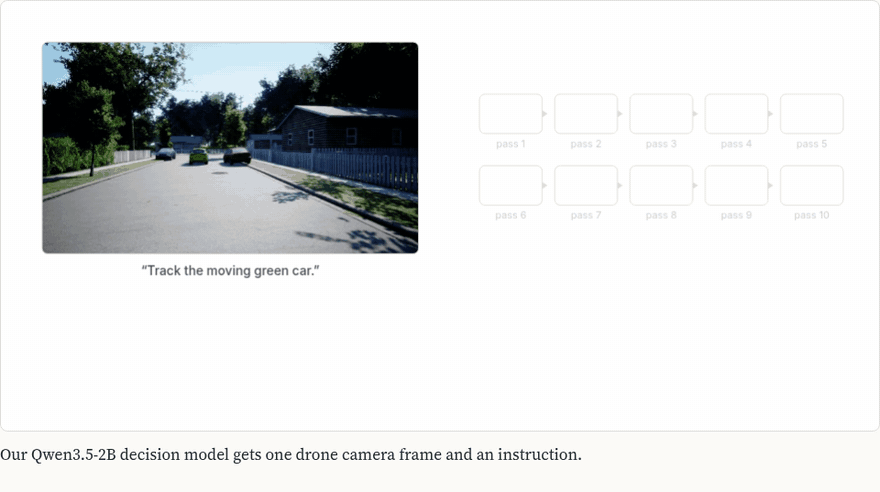
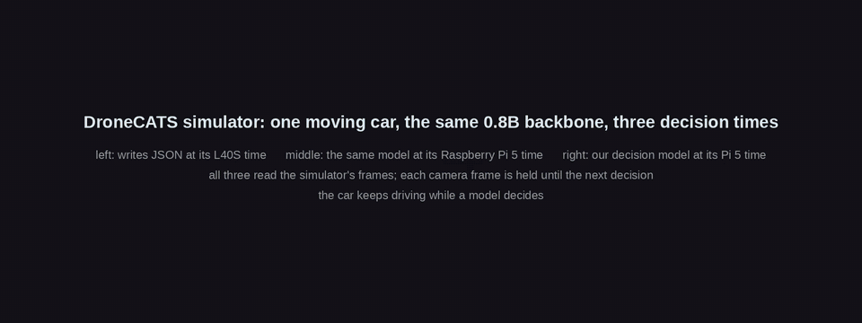

# ReadPoint

**Small Vision-Language Models Are Fast Self-Checking Pointing Decision Models**<br>
NAVER Cloud AI

[[Project page]](https://naver-ai.github.io/ReadPoint/) [Preprint: coming soon] [Code: coming soon] [Models: coming soon]

A VLM that points writes a coordinate digit by digit. Every prefix of those digits is known in advance, so one forward
pass can read the probability of each next digit, and with it the probability of every point. Read this way, a VLM is a
pointing decision model: as accurate as the point it writes, 2.4&ndash;2.8&times; faster, and with a confidence. Training
on boxes as sets that hold the answer adds 1.9&ndash;4.4 pp of accuracy for twelve VLMs, and a self-check tells an agent
when to act. At a Raspberry Pi 5's speed, our 0.8B model reaches 11.0 of 80 drone targets, against at most 4.7.

<p align="center"></p>
<p align="center"><sub>The real read of our Qwen3.5-2B decision model on one DroneCATS frame: ten passes to write the point, one to read every point's probability and the self-check.</sub></p>

<p align="center"></p>
<p align="center"><sub>At a Raspberry Pi 5's decision speed, the 0.8B JSON writer loses the car (middle); our 0.8B decision model reaches it (right). Left: the same writer at GPU speed.</sub></p>

## Code and models

The code (the read, the training recipe, the evaluation and the Raspberry Pi 5 tools) and the trained adapters will be
released in this repository.

## License

This repository is released under the [Apache License 2.0](LICENSE).

## Citation

```bibtex
@misc{kim2026readpoint,
  title  = {Small Vision-Language Models Are Fast Self-Checking Pointing Decision Models},
  author = {Kim, Geewook},
  year   = {2026},
  url    = {https://naver-ai.github.io/ReadPoint/}
}
```
